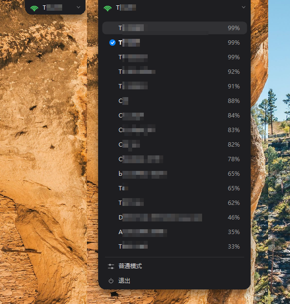

# WiFiBar

一个 Windows 上的 WiFi 状态条。贴着屏幕顶边显示当前网络，点开是一个 macOS 风格的下拉面板，可以直接切换网络。

没有依赖、没有安装程序，编译出来就是一个几十 KB 的 exe。



## 特性

- **刘海屏模式**：贴顶居中的胶囊条，点开是圆角深色面板，带缓动展开动画
- **普通模式**：可拖动的悬浮条，展开面板时按屏幕剩余空间自动选择向上或向下展开
- **网络列表**：实时信号强度、当前网络蓝勾标记、整行悬停高亮、滚轮滚动
- **主动扫描**：通过 `WlanScan` 命令系统真正扫一次，而不是只读服务缓存
- **左键连接**：点网络名直接连接已保存的配置文件
- **右键显示桌面**：等价于 Win+D
- 单实例运行、位置记忆、柔和投影

## 系统要求

- Windows 10 / 11
- .NET Framework 4.x（系统自带，无需单独安装）
- 带无线网卡的设备
- 一般不需要管理员权限（个别被组策略限制的机器上，切换网络可能被拒绝）

## 使用

| 操作 | 效果 |
| --- | --- |
| 左键点击条子 | 展开面板 |
| 左键点击网络 | 连接并收起面板 |
| 左键点击头部 | 收起面板 |
| 右键点击 | 显示桌面（Win+D） |
| 拖动条子 | 移动位置，松开后自动吸附屏幕边缘（仅普通模式、收起状态） |
| 滚轮 | 滚动网络列表 |
| Esc | 收起面板 |

面板底栏有两行：

- **普通模式 / 刘海屏模式**：在两种形态之间切换
- **退出**：关闭程序

## 编译

单文件源码，用 .NET Framework 自带的 `csc` 就能编译，不需要 Visual Studio 工程：

```bat
C:\Windows\Microsoft.NET\Framework64\v4.0.30319\csc.exe ^
  /target:winexe ^
  /out:WiFiBar.exe ^
  /win32icon:pics\WiFiBar.ico ^
  /r:System.dll /r:System.Drawing.dll /r:System.Windows.Forms.dll ^
  WiFiBar.cs
```

也可以直接在「Developer Command Prompt for VS」里执行同样的命令。

## 目录结构

```
WiFiBar.cs            全部源码（界面绘制 + 业务逻辑，单文件）
pics/WiFiBar.ico      程序图标，编译时以 /win32icon 嵌入 exe
pics/screenshot.png   README 用截图
WiFiBar.exe           编译产物
bak/                  历史备份
```

## 实现说明

- 界面全部用 GDI+ 手绘（`GraphicsPath` + `SmoothingMode.AntiAlias`），没有使用任何第三方控件库
- 投影是一个独立的分层窗口（`UpdateLayeredWindow` + 高斯近似模糊），始终排在主窗口下方
- 展开/收起是 15ms 定时器驱动的 `easeOutCubic` 插值，同时改变宽度、高度、圆角和透明度
- 窗口形状通过 `Region` 裁成圆角，避免直角穿透

WiFi 相关能力：

| 用途 | 方式 |
| --- | --- |
| 读取当前连接与信号 | `netsh wlan show interfaces` |
| 读取网络列表 | `netsh wlan show networks mode=bssid` |
| 读取已保存配置 | `netsh wlan show profiles` |
| 触发真实扫描 | `wlanapi.dll` 的 `WlanScan`（netsh 只读缓存，不会主动扫） |
| 连接网络 | `netsh wlan connect name=... ssid=...` |

输出同时兼容中文和英文系统的 `netsh` 文案。

## 配置与日志

- 窗口位置：`%APPDATA%\WiFiBar\position.txt`，删除后恢复默认位置
- 异常日志：exe 同目录的 `WiFiBar.log`（仅在出错时生成）

## 已知限制

- 只能连接已经保存过配置文件的网络
- 不显示隐藏 SSID
- 只适配了中文 / 英文的 `netsh` 输出，其他语言环境可能解析失败
- 刘海屏模式默认居中于主显示器

## License

暂未指定。如果要正式开源，建议补一个 `LICENSE` 文件（例如 MIT）。
